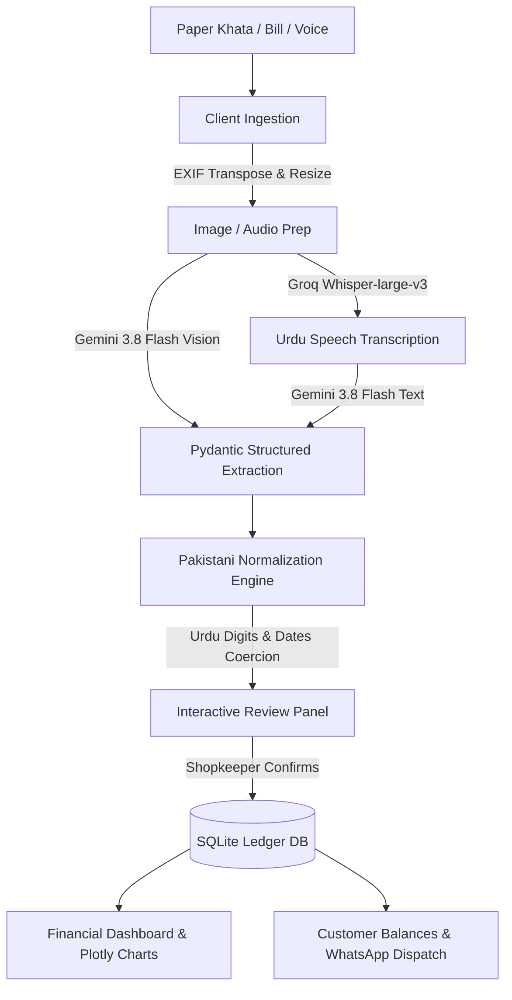

# 📒 Hisaab AI (حساب) — AI Bookkeeper for Pakistani Kiryana Stores

> **Photo and voice bookkeeping for Pakistan's kiryana shops: it reads the paper khata they already keep.**  
> Built for the **BUILD WITH AI Hackathon 2026**

[](https://www.python.org/)
[](https://streamlit.io/)
[](https://ai.google.dev/)
[](https://groq.com/)
[](LICENSE)

---

## 📌 Problem Statement

Pakistan has an estimated **700,000–900,000 kiryana and grocery shops**, which handle most of the country's grocery buying, and many still run on pen and paper ([Dawn Aurora](https://aurora.dawn.com/news/1141706), [TechCrunch 2022](https://techcrunch.com/2022/09/06/snappretail-helps-pakistans-kiryanas-compete-against-supermarkets)). Customer credit (**udhaar / ادھار**) is written by hand in a register (**khata / کھاتہ**).

### Real-world challenges
1. **Lost and damaged registers:** a torn or lost khata means credit that can't be recovered.
2. **Disputed amounts:** unclear handwriting and hand-added totals cause arguments with regular customers.
3. **Missed bill deadlines:** late-payment surcharges on IESCO, LESCO, K-Electric, SNGPL and PTCL bills eat into thin margins.
4. **The typing barrier:** existing khata apps still need every entry typed, in the middle of a counter rush.

**Hisaab AI solves this with zero typing:**
> *Snap a photo of your paper register, invoice, or utility bill — or simply speak a voice note in Urdu — and get an auditable, verified digital ledger.*

---

## 🥇 Why Hisaab AI is different

Existing khata apps in Pakistan (Udhaar Book, DigiKhata, Easy Khata) digitise the ledger but still need every entry **typed**. Hisaab AI removes the typing:

| | Hisaab AI | Pakistani khata apps checked |
|---|---|---|
| Reads a photo of the handwritten khata page | ✓ | Not found |
| Scans IESCO / SNGPL / PTCL bills and warns before the due date | ✓ | Not found |
| Urdu / Roman Urdu voice entry | ✓ | Not found |
| Answers questions about the ledger in Urdu or English | ✓ | Not found |
| AI-written, polite WhatsApp reminders in 3 scripts | ✓ | Fixed templates |
| Never guesses an amount; human review before saving | ✓ | n/a |

Competitors are ahead on mobile apps, scale, payments and inventory. See the full, sourced [competitive analysis](docs/COMPETITIVE_ANALYSIS.md).

---

## 🚀 Key Features

### 1. 📷 Smart Document Scan (Multimodal OCR)
- **Computer Vision Extraction:** Powered by Google's **Gemini 3.8 Flash** with Pydantic structured schemas.
- **Pakistani Document Support:**
  - Handwritten khata pages (Urdu / Roman Urdu / Urdu digits `۰۱۲۳۴۵۶۷۸۹`).
  - Utility bills: **IESCO, LESCO, SNGPL, PTCL** (extracts due date, amount payable, and billing party).
  - Wholesale supplier invoices & retail receipts (extracts line items, quantities, and rates).
- **Core Principle: AI Proposes, Human Confirms:** A dynamic review editor allows instant number verification before saving.
- **No guessed amounts:** unreadable numbers are dropped with a clear warning instead of being guessed, and nothing is saved until a person reviews it.

### 2. 🎙️ Voice Khata (Speech-to-Ledger)
- **Fast audio transcription:** powered by **Groq Whisper-large-v3**.
- **Colloquial Pakistani Vocabulary:** Custom phonetic prompting recognizing *"udhaar"*, *"wasool"*, *"jama"*, *"chawal"*, *"atta"*, *"cheeni"*, *"rupay"*.
- **Natural Language Parsing:** Converts phrases like *"Ahmed ne 500 rupay ka aata udhaar liya"* into structured credit ledger entries.

### 3. 👥 Customer Khata & WhatsApp AI Reminders
- **Net Balance Tracking:** Real-time customer balances (`Balance = Udhaar Given − Repayments Received`).
- **Culturally Sensitive Reminders:** Generates respectful, neighborhood-appropriate payment reminders in **Roman Urdu**, **Urdu script**, or **English**.
- **One-Click WhatsApp Dispatch:** Direct integration launching WhatsApp Web/Mobile with pre-filled messages and international dialing formats (`923...`).
- **Individual Customer Drilldown:** Expandable timeline history of every transaction for any selected debtor.

### 4. 📊 Financial Dashboard & Overdue Alerts
- **Proactive Bill Alerts:** High-visibility warnings for utility bills due within 3 days or overdue.
- **Key Metrics:** Monthly spending, total outstanding credit, unpaid bills, and recorded counter cash sales.
- **Interactive Plotly Visualizations:** Expense breakdowns by category, monthly spending curves, and 30-day cash sales trends.
- **"Ask Your Hisaab" Financial Q&A:** Conversational inquiries in Urdu or English (*"Who owes me the most?"*, *"Bijli pe kitna kharcha hua?"*) with intelligent offline calculation fallbacks.

### 5. ⚡ Offline Demo Mode
- **Zero-Internet Resilience:** Built specifically for rural deployments and venue connectivity drops.
- **Cached Snapshots:** Automatically caches successful extractions to `demo_cache/`.
- **Honest Fallback:** Clear warning banner when offline results are shown, preventing confusion or silent substitutions.

---

## 🏗️ Technical Architecture

```
hisaab_ai/
├── requirements.txt            # Python dependencies
├── .env.example                # API configuration template
├── db.py                       # SQLite storage, balance aggregations, seed data
├── core.py                     # Multimodal AI pipelines, schemas, normalization engine
├── app.py                      # Multi-tab Streamlit fintech user interface
├── demo_cache/                 # Pre-cached JSON extractions for offline demo mode
│   ├── electricity_bill.json
│   ├── khata_register.json
│   ├── supplier_invoice.json
│   └── grocery_receipt.json
└── test_images/                # Generated sample Pakistani test images
    ├── electricity_bill.png
    ├── khata_register.png
    ├── supplier_invoice.png
    └── grocery_receipt.png
```

### Architecture Flow:


---

## 🛠️ Technology Stack

| Layer | Technologies |
|---|---|
| **Frontend UI** | Streamlit 1.40+, HTML5, CSS3 (Fintech Design System) |
| **Vision AI** | Google Gemini 3.8 Flash (`google-genai` SDK) |
| **Voice AI** | Groq Whisper-large-v3 API |
| **Data Validation** | Pydantic v2 (Strict Schema Enforcement) |
| **Database** | SQLite3 (`hisaab.db` with Thread-Safe Connections) |
| **Analytics & Viz** | Pandas 2.2+, Plotly Express 5.19+ |
| **Image Processing** | Pillow (PIL) with EXIF Transposition |
| **Export Engines** | OpenPyXL (.xlsx) & CSV |

---

## ⚡ Quick Start & Installation

### 1. Clone the Repository
```bash
git clone https://github.com/Huzaifa1102/hisaab-ai.git
cd hisaab-ai
```

### 2. Set Up Virtual Environment (Recommended)
```bash
python -m venv venv
# On Windows:
venv\Scripts\activate
# On Linux/macOS:
source venv/bin/activate
```

### 3. Install Dependencies
```bash
pip install -r requirements.txt
```

### 4. Configure API Keys
Copy `.env.example` to `.env`:
```bash
cp .env.example .env
```
Add your free API keys:
- `GEMINI_API_KEY`: Get free key from [Google AI Studio](https://aistudio.google.com/)
- `GROQ_API_KEY`: Get free key from [Groq Console](https://console.groq.com/)
- `GEMINI_MODEL=gemini-3.8-flash`

*(Note: You can also enter API keys directly in the app's sidebar).*

### 5. Launch the Application
```bash
streamlit run app.py
```
Open **`http://localhost:8501`** in your browser.

---

## 🧪 Testing & Demo Walkthrough

### 1. Load Realistic Demo Ledger
1. Tick **"Replace current ledger with demo data"**, then click **"📥 Load Demo Ledger"** in the sidebar (this replaces the whole ledger).
2. The database instantly populates with 22 realistic transactions:
   - Wholesale inventory purchases (Metro Cash & Carry, Al-Fatah Wholesale)
   - Rent & shop assistant salary
   - Paid gas bill + unpaid IESCO electricity bill (due in 2 days) + unpaid PTCL bill (due in 9 days)
   - Customer credit and partial repayments for 5 customers (*Ahmed Raza, Bushra Bibi, Faisal Khan, Zainab Ali, Hamza*)
   - Daily counter cash sales

### 2. Test Document Extraction
1. Go to **📷 Smart Scan**.
2. Upload any test photo from the `test_images/` directory:
   - `test_images/electricity_bill.png` (Commercial IESCO bill)
   - `test_images/khata_register.png` (Handwritten credit ledger)
   - `test_images/supplier_invoice.png` (Wholesale invoice with line items)
   - `test_images/grocery_receipt.png` (Store receipt)
3. Click **"🚀 Extract with AI"**.
4. Review extracted rows in the interactive table, edit if desired, and click **"💾 Save to Ledger"**.

### 3. Test Offline Demo Mode
1. Enable **"Offline demo mode"** in the sidebar.
2. Upload `test_images/electricity_bill.png`.
3. The app loads pre-cached results from `demo_cache/` instantly with zero network requests and an explicit offline banner.

### 4. Test WhatsApp Khata Reminders
1. Switch to **👥 Udhaar**.
2. Select debtor **Faisal Khan** (Owes Rs 6,200).
3. Select language: **Roman Urdu**, **Urdu Script**, or **English**.
4. Click **"✍️ Draft AI Reminder"** to generate a polite message.
5. Click **"📲 Open in WhatsApp"** to launch WhatsApp Web.

### 5. Automated Test Suites
Run the verified automated test scripts:
```bash
# Test Urdu numerals, currency prefixes, and date normalization:
python test_normalization.py

# Test Streamlit headless rendering on empty and populated DB:
python test_app_smoke.py

# Test voice extraction mocking and demo cache validity:
python test_voice_and_offline.py

# Test error handling, offline fallback, save validation and retry rules (mocked, no API calls):
python test_hardening.py
```
These tests use a temporary database, so they never touch your real `hisaab.db`.

To rebuild `demo_cache/` from real scans (uses your Gemini key, 3 calls per image):
```bash
python test_live_images.py
```

---

## 🏆 Hackathon Alignment (Build With AI Rubric)

- **AI Integration Depth:** Dual-model pipeline combining Gemini 3.8 Flash multimodal structured vision and Groq Whisper audio transcription with strict Pydantic schemas.
- **Problem-Solving Quality:** Tackles the critical root cause of retail debt in informal emerging economies with a strict human-in-the-loop review safeguard.
- **Industrial Impact:** Applicable to an estimated 700,000–900,000 kiryana and grocery shops in Pakistan, and to similar small shops across South Asia.
- **Creativity & SDG Impact:**
  - **SDG 8 (Decent Work and Economic Growth):** Enhances financial resilience for micro-entrepreneurs.
  - **SDG 9 (Industry, Innovation, and Infrastructure):** Digitizes informal paper-based supply chain accounting.

---

## 📄 License
This project is open-source under the [MIT License](LICENSE).
